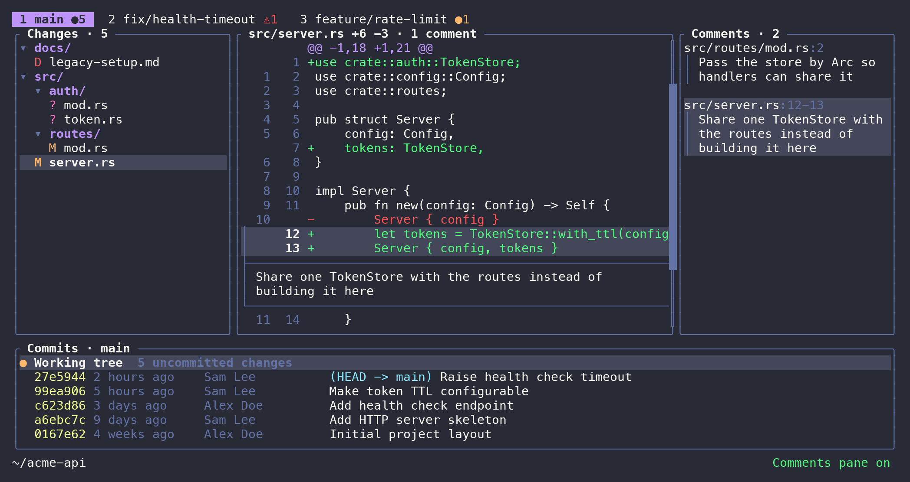

# worktree-monitor (`wtm`)

A live terminal UI for keeping an eye on every git worktree of a repository: what changed, the diff, and the
commit history, side by side and updating in near-realtime.



## Features

- **All worktrees as tabs.** The tab badge shows each worktree's number of uncommitted changes, or `⚠N` when the branch would conflict with the default branch
  (`origin/HEAD`, else `main`/`master`) in N files. The status line names the base branch. Requires git 2.38+.
- **Changed files as a tree:** modified, added, deleted, renamed, untracked and conflicted. Directories are collapsible.
- **Diff view** with old/new line numbers, hunk navigation that continues into adjacent files, line selection, and optional soft wrap (`w`).
- **Commit list.** Select a commit to browse its files and diffs. Select *Working tree* to go back.
- **Line comments.** Press `c` on a selected diff line (or a range selected with `Shift-↓`/`Shift-↑`) to write a
  note right below it. Comments are tied to the file, lines and viewed commit, follow their lines when the file
  changes, and are marked by a bar in the gutter. They are stored as JSON per worktree in `$XDG_STATE_HOME/wtm`
  (default `~/.local/state/wtm`); the format is described by [`schema/comments.schema.json`](schema/comments.schema.json),
  a copy of which is written next to the files and linked from their `$schema`. Files of removed worktrees are
  deleted on startup, unless one of the repository's worktrees is missing (e.g. on an unmounted volume).
- **Comments pane** (`C`) on the right lists every comment of the worktree, working tree and commits alike.
  `Ctrl-n` / `Ctrl-p` (or a click on an entry) jump to a comment, switching to its commit, file and line.
  Once the lines of a working tree comment are committed, the comment moves to that commit; if they can't be found
  in any commit since (e.g. the changes were discarded), it is marked *stale*. Comments on unchanged lines can't be
  traced to a commit and become stale as well.
- **Closing comments.** `x` closes the comment on the selected line (or highlighted in the pane) once it is fixed or
  dropped, and reopens a closed one. Closed comments are hidden; `X` shows them, dimmed. Each records when and by whom
  it was closed; editing its text reopens it. Agents close comments with `wtm comments close` (see [below](#comments-from-the-command-line)), and
  the running app picks up the change within seconds.
- **Copy the file path to the clipboard,** with `:line` (or `:start-end`) appended when diff lines are selected. Uses OSC 52 over SSH.
- **Live updates** from file system events, with a full refresh every 30 seconds as a fallback (2-second polling
  when file watching is unavailable). Adding or removing worktrees updates
  the tabs.
- **Vim-style keys and mouse support:** click, wheel scrolling and tab clicks.
- **Colors** follow your terminal's color scheme by default. A built-in Dracula theme is available.

## Install

Requires `git` 2.38+.

### Prebuilt binaries

Download the archive for your platform from [Releases](https://github.com/teeli/worktree-monitor/releases)
(macOS and Linux, arm64 and x86_64), extract it and put `wtm` somewhere on your `PATH`:

```sh
tar -xzf wtm-vX.Y.Z-<target>.tar.gz
install wtm-vX.Y.Z-<target>/wtm ~/.local/bin/
```

Each archive has a `.sha256` file next to it (`shasum -a 256 -c wtm-vX.Y.Z-<target>.tar.gz.sha256`). The macOS
binaries are not signed; if Gatekeeper blocks `wtm`, run `xattr -d com.apple.quarantine ~/.local/bin/wtm`.

### From source

Requires a Rust toolchain (`rustup`).

```sh
cargo install --path .
```

This installs `wtm` into `~/.cargo/bin`. Make sure that directory is on your `PATH`.

## Usage

Run `wtm` anywhere inside a git repository or one of its worktrees:

```sh
wtm
wtm --theme dracula      # or: export WTM_THEME=dracula
```

### Comments from the command line

`wtm comments list`, `close` and `reopen` work on the comments of the worktree they are run in, e.g. for an AI agent
that has handled review comments. (`wtm comments prune` is different: it covers all repositories, see
[below](#cleaning-up-comment-files).)

```sh
wtm comments list                     # open comments: id, file:line, commit, body
wtm comments list --all --json        # include closed ones, as JSON (schema/comments.schema.json, ids as strings)
wtm comments close <ID>... --by NAME  # close fixed or dropped comments (--by defaults to "agent")
wtm comments reopen <ID>...
```

They find the worktree from any subdirectory, like git. Ids are 19-digit integers, beyond what many JSON parsers
represent exactly, so `--json` prints them as strings. Editing a closed comment's text reopens it.

### Cleaning up comment files

Comment files of removed worktrees are deleted when `wtm` starts in their repository, unless one of its
worktrees is missing. To clean up all repositories at once, without starting the TUI:

```sh
wtm comments prune                    # list comment files whose worktrees were removed
wtm comments prune --yes              # delete them
wtm comments prune --deleted-repos    # also include repositories that no longer exist
wtm comments prune --age 30           # also include files with no comment added or edited in 30 days
```

Worktrees git still lists are kept even when their directory is missing, e.g. on an unmounted volume; after deleting
one without `git worktree remove`, run `git worktree prune` first.
`--deleted-repos` treats any repository missing from disk as deleted, including one on an unmounted volume, and also
includes files from older versions of `wtm` that didn't record their repository. `--age` applies to every file,
including those of existing worktrees.

## Keys

Press `?` in the app for the full list.

| Where | Keys | Action |
|---|---|---|
| General | `r` · `?` · `q` | Refresh · help · quit |
| | `y` / `Y` | Copy relative / absolute path (`:line` if a line is selected) |
| Worktrees & history | `1`…`9`, `,` / `.` (also `[` `]`, `gT` `gt`) | Switch worktree |
| | `n` / `p` | Next / previous file (or collapsed directory) |
| | `N` / `P` | Next (older) / previous (newer) commit |
| Diff | `j` `k` (also `}` `{`) | Next / previous hunk, continuing into adjacent files |
| | `↓` `↑` | Move the line selection |
| | `Shift-↓` `Shift-↑` | Extend the line selection to a range |
| | `h` `l` / `←` `→` | Scroll horizontally |
| | `w` | Toggle soft wrap (off by default) |
| | `Ctrl-d` `Ctrl-u`, `PgDn` `PgUp`, `gg` `G` | Half page / page / top / bottom |
| | `Esc` | Clear line selection |
| Comments | `c` | Comment on the selected line (edit if it has one; save empty to delete) |
| | `C` | Toggle the comments pane |
| | `Ctrl-n` / `Ctrl-p` | Jump to next / previous comment (switching commit and file as needed) |
| | `x` | Close / reopen the comment on the selected line (else the one highlighted in the pane) |
| | `X` | Show / hide closed comments |
| File tree | `Enter` / `Space` | Toggle directory (of the current file) |
| | `H` / `Shift-←` | Collapse directory and all subdirectories |
| | `L` / `Shift-→` | Expand directory and all subdirectories |
| | `z` / `Z` | Collapse / expand all directories |

## Development

```sh
cargo test
cargo clippy --all-targets -- -D warnings
cargo fmt --check
uv run scripts/screenshot.py   # regenerate docs/screenshot.png
```

`scripts/screenshot.py` builds `wtm` and creates a throwaway demo repository with several worktrees. It drives the
app in a pseudo-terminal and renders the screen to `docs/screenshot.png`. Regenerate the screenshot whenever a change
affects what the UI looks like.

CI (`.github/workflows/ci.yml`) runs formatting, clippy, tests (Linux and macOS), rustdoc and actionlint on every
pull request and push to `main`.

## Releasing

Versions follow [semver](https://semver.org). Pushing a `vX.Y.Z` tag runs `.github/workflows/release.yml`, which
builds the binaries and publishes a GitHub Release with generated notes. The tag must match the `version` in
`Cargo.toml` and point to a commit on `main`; tags with a pre-release suffix (`v1.0.0-rc.1`) become pre-releases.

1. Bump `version` in `Cargo.toml` (and `Cargo.lock`, via `cargo check`) in a PR and merge it.
2. Tag `main` and push the tag:

   ```sh
   git fetch origin
   git tag -a vX.Y.Z -m vX.Y.Z origin/main
   git push origin vX.Y.Z
   ```

In Claude Code, the `create-release` skill walks through these steps and verifies the result.

## License

[MIT](LICENSE)
