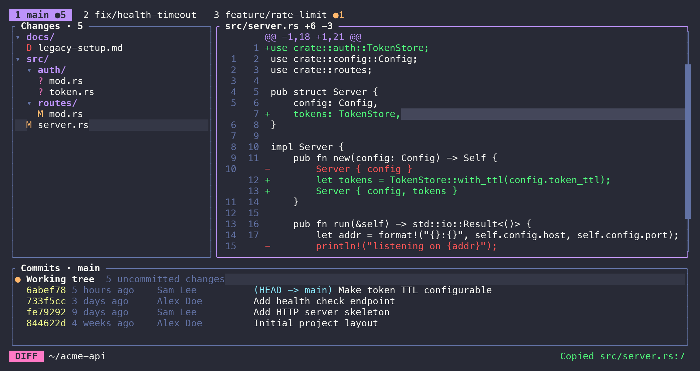

# worktree-monitor (`wtm`)

A live terminal UI for keeping an eye on every git worktree of a repository: what changed, the diff, and the
commit history, side by side and updating in near-realtime.



## Features

- **All worktrees as tabs.** The tab badge shows each worktree's number of uncommitted changes.
- **Changed files as a tree:** modified, added, deleted, renamed, untracked and conflicted. Directories are collapsible.
- **Diff view** with old/new line numbers, hunk navigation that continues into adjacent files, and line selection.
- **Commit list.** Select a commit to browse its files and diffs. Select *Working tree* to go back.
- **Copy the file path to the clipboard,** with `:line` appended when a diff line is selected. Uses OSC 52 over SSH.
- **Live updates** from file system events, with a 2-second polling fallback. Adding or removing worktrees updates
  the tabs.
- **Vim-style keys and mouse support:** click, wheel scrolling and tab clicks.
- **Colors** follow your terminal's color scheme by default. A built-in Dracula theme is available.

## Install

Requires `git` and a Rust toolchain (`rustup`).

```sh
cargo install --path .
```

This installs `wtm` into `~/.cargo/bin`. Make sure that directory is on your `PATH`.

## Usage

Run `wtm` anywhere inside a git repository or one of its worktrees:

```sh
wtm
wtm --theme dracula      # or: export WTM_THEME=dracula
```

## Keys

Press `?` in the app for the full list.

| Where | Keys | Action |
|---|---|---|
| Global | `Tab` / `Shift-Tab` | Focus next / previous pane |
| | `1`…`9`, `,` / `.` (also `[` `]`, `gT` `gt`) | Switch worktree |
| | `n` / `p` | Next / previous file |
| | `N` / `P` | Next (older) / previous (newer) commit |
| | `y` / `Y` | Copy relative / absolute path (`:line` if a line is selected) |
| | `j` `k` `↓` `↑`, `Ctrl-d` `Ctrl-u`, `PgDn` `PgUp`, `gg` `G` | Move / scroll in the focused pane |
| | `r` · `?` · `q` | Refresh · help · quit |
| File tree | `h` `l` / `←` `→` | Collapse / expand directory |
| | `H` `L` / `Shift-←` `Shift-→` | Collapse / expand directory and all subdirectories |
| | `Enter` / `Space` | Toggle directory |
| Diff | `j` `k` (also `}` `{`) | Next / previous hunk, continuing into adjacent files |
| | `↓` `↑` | Move the line selection |
| | `h` `l` / `←` `→` | Scroll horizontally |
| | `Esc` | Clear line selection |
| Commits | `Enter` / `Space` | Show the commit (top row: working tree) |
| | `Esc` | Back to working tree |

## Development

```sh
cargo test
cargo clippy --all-targets -- -D warnings
cargo fmt --check
uv run scripts/screenshot.py   # regenerate docs/screenshot.png
```

`scripts/screenshot.py` builds `wtm` and creates a throwaway demo repository with several worktrees. It drives the
app in a pseudo-terminal and renders the screen to `docs/screenshot.png`. Regenerate the screenshot whenever a change
affects what the UI looks like.
